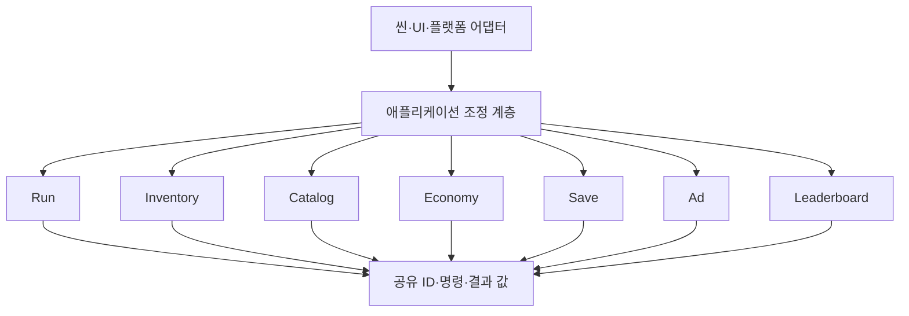

# KAN-19 도메인 모듈 및 이벤트 계약

이 문서는 첫 플레이 루프와 후속 모듈이 함께 사용할 데이터와 상태 변경의 경계를 정의한다. 기준은 「귀환의 무기고 최종 게임 기획서 v3.0」 2~3·6~9쪽과 Unity 구조 조사 결과다. [KAN-19](https://gametithe.atlassian.net/browse/KAN-19) · [KAN-16](https://gametithe.atlassian.net/browse/KAN-16)

## 모듈 책임과 의존성

| 모듈 | 소유하는 상태와 책임 |
| --- | --- |
| Run | 현재 탐험 ID, 구역, 반입 명세 참조, 전리품 변경 이력과 읽기 전용 스냅샷, 임시 코인, 귀환 상태와 탐험 종료 결과를 소유한다. 출격·귀환 취소·종료의 허용 전이를 판정한다. |
| Inventory | 무기 실물 위치의 단일 변경 권한을 가지며, 보관·장착·운반·탐험 예약 상태를 소유한다. 슬롯 이동과 삽입·제거의 조건을 검증한다. |
| Catalog | 무기 원형별 발견·회수·숙련 기록을 소유한다. 실물 ID의 소유 상태와 무기 원형별 도감 기록은 별개의 데이터다. |
| Economy | 확정 코인 잔고와 거래 내역을 소유한다. 구매·판매·뽑기·정산에서 적용할 코인 변경안을 계산한다. |
| Save | 버전이 지정된 스냅샷과 거래 적용 기록의 저장·교체·복구를 담당한다. 교체 성공 여부와 확정 버전을 반환한다. |
| Ad | 광고 완료 검증, 완료 식별자, 일일 사용 제한을 담당한다. 검증 결과와 보상 요청을 조정 계층에 제공한다. |
| Leaderboard | 제출·검증·기록 갱신을 담당한다. 일반 탐험은 확정된 정산 결과를 소비하고, 온라인 주간 도전의 조건 발급·결과 검증은 신뢰하는 서버 경계를 거친다. |

화살표는 호출하는 쪽에서 의존하는 쪽으로 향한다. 애플리케이션 조정 계층은 여러 모듈의 변경안을 모아 한 번 저장하고, 저장 결과에 따라 확정된 상태를 공개한다. Save는 전달받은 직렬화 스냅샷을 처리한다. 이벤트 구독은 조정 계층이 연결하고, 모듈은 이벤트 값 또는 타입만 받아 처리한다.

공유 값은 의존성 그래프의 잎이다. 구독 모듈에서 시작한 후속 명령도 조정 계층을 통과한다. 예를 들어 광고 보상 요청은 Ad에서 검증하고 Inventory와 Economy가 변경안을 내며, 조정 계층이 광고 사용 기록을 포함해 저장 결과를 확정한다.

## 공통 데이터

| 값 | 계약 |
| --- | --- |
| `RunId` | 한 번의 출격을 식별하는 불투명하고 안정적인 ID. 유효한 출격에 최초 발급해 반입 명세와 묶으며, 재전송·재시도·저장 왕복에서 동일한 값을 사용한다. 새 탐험에 이전 ID를 재사용할 수 없다. |
| `WeaponDefinitionId`, `WeaponInstanceId` | 원형과 실물의 식별형을 분리한다. 같은 원형의 여러 실물마다 고유 ID가 있고, 이동·저장 후에도 유지한다. 중복 실물 ID는 데이터 오류다. [KAN-63](https://gametithe.atlassian.net/browse/KAN-63) |
| `WeaponDefinition` | 안정적 원형 ID, 표시 이름, 등급 (1~5), 기본공격·스킬·VFX 참조. 원형 ID 중복, 필수 참조 누락, 등급 범위 초과를 검출한다. 실물의 위치·대여·잔고는 별도 상태로 저장한다. [KAN-187](https://gametithe.atlassian.net/browse/KAN-187) |
| `WeaponInstance` | 실물 ID, 원형 ID, 대여 여부, 소유 위치 또는 귀속 탐험 ID. 창고·장착·운반·탐험 예약 등 현재 위치는 동시에 하나다. [KAN-71](https://gametithe.atlassian.net/browse/KAN-71) |
| `ZoneDefinition` | 안정적 구역 ID, 테마, 권장 등급, 보상 등급 최소·최대, 제한시간 (초), 일반 상자 등급 확률 (0~10,000bp, 합계 10,000bp = 100%). 확률은 보상 범위 밖에서 0이며 제한시간은 양수다. 권장 등급은 안내에 쓴다. 수치와 콘텐츠는 후속 티켓에서 정의한다. [KAN-88](https://gametithe.atlassian.net/browse/KAN-88) |
| `TransactionId`, `SnapshotRevision` | 거래 종류와 원천 식별자에서 안정적으로 얻는 적용 키와 저장 버전. 탐험 정산의 적용 키는 고정된 `RunSettlement`와 `RunId`의 조합이다. 성공과 실패가 같은 키를 사용한다. 광고 지급은 검증된 완료 식별자를 사용한다. 버전 충돌 시 활성 스냅샷을 다시 읽고 기존 변경안을 재검증한다. |
| `CoinAmount` | 코인 개수의 정수 값. 확정 잔고와 탐험 임시 잔고를 별도 항목으로 두며, 실패한 거래는 확정 잔고나 임시 잔고를 부분 갱신하지 않는다. |

반입 명세에는 출격 직전 예약한 개인 소유 실물과 대여 실물을 구분해 담는다. 출격 시점의 명세는 이후 이동이나 획득으로 변하지 않는다. 예약 중 실물은 창고에서 다시 사용할 수 없다. 예약·명세 고정·출격 시작 중 실패하면 예약 상태를 출격 전으로 복구한다. [KAN-85](https://gametithe.atlassian.net/browse/KAN-85)

## 탐험 전이 및 타이머

| 현재 상태 | 입력 | 결과 |
| --- | --- | --- |
| 마을 | 구역과 출격 준비가 유효한 시작 요청 | 새 `RunId`의 탐험을 시작한다. |
| 탐험 | 귀환진에서 들어온 유효한 시작 요청 | 새 귀환 시도 ID로 귀환 중 상태에 진입한다. |
| 귀환 중 | 피해 또는 유효한 이동 취소 요청 | 해당 시도를 취소하고 탐험으로 돌아간다. 지난 시도의 완료 신호는 무시한다. |
| 귀환 중 | 현 시도가 중단 없이 3초를 채우고 제한시간 전에 완료 | 성공으로 단일 확정한다. |
| 탐험 또는 귀환 중 | 사망 또는 시간초과 | 실패로 단일 확정한다. |
| 성공 또는 실패 | 해당 탐험의 추가 종료 요청 | 최초 확정 결과를 반환한다. 새 종료 이벤트나 정산 요청은 생성하지 않는다. |

- Run은 주입받은 단조 증가 탐험 시계를 사용한다. 시작 시점, 제한 만료 시점, 채널링 예정 완료 시점은 같은 시계 단위로 비교한다. HUD의 반올림 값과 시스템 벽시계는 경계 판정 입력에서 제외한다.
- 완료 시점은 채널링 시작에서 3초가 지난 시점이다. `완료 시점 < 만료 시점`일 때만 성공 후보로 인정한다. 만료 시점과 정확히 같으면 시간초과다. 프레임이 두 시점을 건너뛰어도 유효 시점과 귀환 시도 ID로 비교한다.
- 같은 프레임의 요청은 프레임 콜백 순서에 의존하지 않도록 한 판정 단계에서 수집하고 유효 시점 순으로 비교한다. 기능 검증에서는 동일 시점의 취소 또는 사망을 먼저 반영해 생존·무중단 조건을 검사한다. 이 동시 입력 순서는 결정적 테스트용 계약이며, 이동 취소 기준과 전투 세부 규칙은 별도 승인에서 다룬다.
- 완료 후보의 유효 시점까지 채널링이 유효했는지 검사한 뒤 결과 확정을 한 번의 전이로 적용한다. 타이머·피해·채널링 어댑터는 요청만 만들며 최종 결과 발행은 Run이 맡는다. 앱 종료·백그라운드·재접속 중의 시계 정책은 승인 대기다. [KAN-47](https://gametithe.atlassian.net/browse/KAN-47) · [KAN-83](https://gametithe.atlassian.net/browse/KAN-83) · [KAN-89](https://gametithe.atlassian.net/browse/KAN-89) · [KAN-188](https://gametithe.atlassian.net/browse/KAN-188) · [KAN-190](https://gametithe.atlassian.net/browse/KAN-190)

## 이벤트 발행과 저장

| 이벤트 | 발행 주체와 시점 | 전달하는 값과 소비자 |
| --- | --- | --- |
| `RunStarted` | Run이 유효한 탐험 시작을 확정한 직후 | `RunId`, 구역 ID, 시작·만료 시점. HUD와 진행 표시가 읽는다. |
| `ExtractionStateChanged` | Run이 귀환 시작·취소를 반영한 직후 | `RunId`, 귀환 시도 ID, 상태, 시점, 취소 사유. HUD가 시계로 진행률을 표시하고 자동공격 어댑터가 귀환 중 공격을 중지한다. |
| `RunLootChanged` | Inventory가 탐험 실물 위치 변경을 수락한 뒤 Run이 새 전리품 스냅샷을 반영하거나, Run이 임시 잔고를 갱신한 직후 | `RunId`, 변경 후 전리품·임시 코인과 변경 식별자. HUD와 지표 계층이 소비한다. |
| `RunResultFinalized` | Run이 성공·실패를 최초 확정한 직후, `RunId`당 한 번 | `RunId`, 구역 ID, 결과·사유, 확정 시점·잔여 시간, 보스 처치 여부, 최초 반입 명세, 종료 시 실제 소지한 실물 목록, 최종 전리품·임시 코인 스냅샷. 각 실물의 개인 소유·대여·탐험 획득 출처를 유지한다. 조정 계층이 정산을 시작한다. |
| `RunSettlementCommitted` | 조정 계층이 정산 스냅샷 저장 성공을 확인한 뒤 | `RunId`, 거래 ID, 확정 버전, 회수·손실·등록·코인 변경 요약. 정산 UI, 구역 해금, 랭킹, 지표가 소비한다. |
| `InventoryChanged`, `CatalogChanged`, `WalletChanged` | 해당 도메인의 변경이 확정된 뒤 조정 계층이 발행 | 변경 종류, 거래 ID, 변경 후 값 또는 delta, 확정 버전. 창고·도감·상점 UI가 소비한다. |
| `SaveFailed` | Save의 실패 결과를 받은 조정 계층이 발행 | 거래 ID, 실패 종류, 재시도 가능 여부. UI는 저장 상태를 안내하고 재시도 시 같은 거래 ID를 사용한다. |
| `AdCompletionVerified` | Ad가 유효한 완료 증빙을 검증한 뒤 | 검증된 완료 ID와 일일 제한 검증에 필요한 값. 조정 계층이 지급을 요청한다. 지급 표시는 저장 성공 후의 확정 상태로 갱신한다. |
| `LeaderboardResultAccepted` | Leaderboard가 제출 검증과 기록 갱신을 수락한 뒤 | 제출 ID와 확인된 기록. 랭킹 UI가 소비한다. |

1. 정산 조정 계층은 확정된 Run 결과와 당시 활성 스냅샷을 입력으로 변경안을 계산한다. 같은 `RunId`의 완료 결과가 저장돼 있으면 기존 기록을 반환하고, 다른 종료 결과가 같은 ID로 도착하면 충돌로 거절한다.
2. 성공은 실제 회수할 수 있는 소유 반입품과 획득품을 반영하고 임시 코인을 확정 잔고에 더한다. 새 도감 회수는 실제 소지한 채 성공 귀환한 정산 항목을 기준으로 평가한다. 뽑기 지급만으로 회수 기록을 생성하지 않는다.
3. 사망·시간초과는 반입품, 전리품, 임시 코인을 상실 처리한다. 미반입 창고 재산과 이전 확정 코인·회수 기록은 유지한다. 대여품은 종료 결과와 무관하게 탐험에서 사라지며 판매·창고 저장 대상에서 제외한다.
4. 변경안의 무기·코인·도감·정산 기록을 같은 저장 버전으로 교체한다. 저장에 실패하면 이전 정상 스냅샷을 계속 제공하고 해당 탐험은 정산 대기 상태로 유지한다. 런 결과와 변경안의 입력은 재시도에 사용할 수 있게 유지한다.
5. 교체 후 응답만 유실된 경우 같은 키로 재요청하면 기존 정산 기록을 반환한다. 복구는 이전 또는 다음 정상 버전을 로드한다. 소비자는 거래 ID로 알림·보상을 멱등 처리한다. 전달 시점과 저장 시점은 구분하며, 클라우드 권위, 프로세스 종료 중 재전달 방식과 복구 사용자 경험은 후속 계약에서 정한다. [KAN-73](https://gametithe.atlassian.net/browse/KAN-73) · [KAN-87](https://gametithe.atlassian.net/browse/KAN-87) · [KAN-90](https://gametithe.atlassian.net/browse/KAN-90) · [KAN-96](https://gametithe.atlassian.net/browse/KAN-96)

## 전투 표적 및 피해의 공통 입력

Unity 어댑터는 후보에 안정적 `TargetId`, 같은 XY 월드 좌표계의 기준점, 생존 여부, 공격 대상 유효 여부를 담아 전달한다. 여러 콜라이더는 동일한 `TargetId`와 기준점으로 정규화한다. 표적 조회는 공격 원점과 사거리를 월드 단위로 받아 유효 후보의 제곱거리를 비교한다. 경계 거리는 포함한다. 거리 동률은 안정적인 ID의 서수 비교 순으로 고정해 후보 나열 순서가 선택에 영향을 주지 않게 한다. 유효 후보가 없으면 대상 없음으로 반환한다. [KAN-52](https://gametithe.atlassian.net/browse/KAN-52)

범위 피해 요청에는 공격 적용 ID, 공격자 ID, XY 원점, 정규화 가능한 방향, 원 또는 부채꼴의 반경·각도와 피해 값이 들어간다. 부채꼴은 중심 방향과 전체 각도를 도 단위로 사용하며, 그 절반을 중심 방향 양쪽의 포함 경계로 쓴다. 범위 내 여러 콜라이더가 같은 실물을 가리키면 공격 적용 ID와 표적 ID 조합당 피해를 한 번 요청한다. 지속 피해에서 서로 다른 타격 간격을 의도한 경우 각 간격의 적용 ID를 별도로 부여한다. 판정 결과는 표적 ID와 요청 피해를 반환하고, HP·사망 변경은 피해 수신 경계에서 처리한다. 스킬별 피해량·사거리·각도와 회피 정책은 각 제작 또는 결정 티켓에서 다룬다. [KAN-70](https://gametithe.atlassian.net/browse/KAN-70) · [KAN-77](https://gametithe.atlassian.net/browse/KAN-77)

## 검증 계약

기능 검증은 탐험 시계, 저장소, ID 발급기, 후보 목록을 테스트에서 주입한다. 아래 수치는 재현 입력이다. KAN-19에서 코드나 테스트 프레임워크를 추가하지 않으며, 실행 테스트는 각 구현과 테스트 틀 티켓에서 작성한다. [KAN-34](https://gametithe.atlassian.net/browse/KAN-34)

| 입력 | 기대 결과 |
| --- | --- |
| 제한 만료 10.000초, 귀환 시작 6.999초 | 9.999초에 귀환 성공. 동일 프레임에 만료 요청이 도착해도 성공 한 건이 유지된다. |
| 제한 만료 10.000초, 귀환 시작 7.000초 | 완료 후보와 만료가 같은 10.000초다. 시간초과 한 건이 확정된다. |
| 채널링 2초에 피해, 이후 기존 시도의 완료 신호 | 귀환이 취소되며 기존 완료 신호는 무시된다. 새 시도는 실제 새 시작 시점부터 3초가 지나야 완료 후보가 된다. |
| 귀환 완료와 사망 접수 순서를 바꿔 같은 프레임에 전달 | 사망 시점이 귀환 완료보다 이르면 실패 한 건. 귀환 완료가 더 이르고 유효하면 성공 한 건. 동일 시점에 적용하는 테스트 규칙에서는 생존 조건이 충족되지 않는다. |
| 반입품과 전리품, 임시 코인이 있는 탐험에서 사망 | 반입품과 전리품·임시 코인 상실. 미반입품과 이전 코인·도감 기록 유지. |
| 저장 교체 전 실패 후 같은 `RunId`로 반복 재시도 | 실패 동안 확정 버전·재산은 이전 값. 성공한 뒤 재호출은 같은 정산 기록을 얻고 추가 지급은 없다. |
| 거리 동률인 생존 후보의 입력 순서를 바꾸고 중복 콜라이더를 추가 | 동일 ID가 선택되며, 같은 공격 적용에 그 표적의 피해 요청은 한 건이다. 범위 또는 유효성 경계에 실패하면 선택·피해에서 제외된다. |

## 승인 대기 정책

| 결정 영역 | 계약에서 넘기는 값 |
| --- | --- |
| 반입 슬롯, 폐기한 반입품, 대여 종류·수량·슬롯 점유 | 최초 반입 명세, 귀환 시 실제 소지 목록 및 대여 여부를 정산 입력에 남겨 정책 확정 후 계산에 사용한다. [KAN-45](https://gametithe.atlassian.net/browse/KAN-45) |
| 중도 종료, 이동 취소 기준, 도감 발견·대여 등록·숙련 | 각 런의 종료·취소 사유와 실제 회수 목록을 사용한다. [KAN-47](https://gametithe.atlassian.net/browse/KAN-47) · [KAN-49](https://gametithe.atlassian.net/browse/KAN-49) · [KAN-190](https://gametithe.atlassian.net/browse/KAN-190) |
| 계정·저장 권위·오프라인, 광고 제공자·초기화·인증 | 저장 버전과 적용 키를 유지한다. 광고 서비스의 기획 제한은 계정당 하루 최대 2회다. 날짜 경계와 검증 식별자 규칙은 결정 후 연결한다. [KAN-53](https://gametithe.atlassian.net/browse/KAN-53) · [KAN-55](https://gametithe.atlassian.net/browse/KAN-55) |
| 중복 판매 가격, 랭킹의 반출 가치·동률·주간 점수 | 거래와 제출 입력에 원천 ID를 제공한다. 순위·보상의 가치는 해당 결정에서 정의한다. [KAN-51](https://gametithe.atlassian.net/browse/KAN-51) · [KAN-61](https://gametithe.atlassian.net/browse/KAN-61) |
